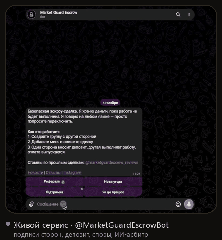

# TRON Escrow Bot — сделки без живого гаранта

Эскроу-сервис для сделок по продаже Telegram-каналов. USDT держит смарт-контракт
в сети TRON, а не человек: владелец сервиса не может забрать средства никак —
это свойство кода в публичном обозревателе, а не обещание в оферте.

**Живой бот:** [@MarketGuardEscrowBot](https://t.me/MarketGuardEscrowBot)
**Контракт в обозревателе:** [nile.tronscan.org](https://nile.tronscan.org/#/contract/TUu9z2nt7R43n3SqcgBmC3LNqdzdsFSaF6)

> «Я проверил смарт-контракт — по тестам всё зелёное и работает»
> — владелец сервиса, приёмка перед передачей прав

## Как двигаются деньги

Покупатель переводит USDT на адрес смарт-контракта. Дальше только три сценария:

| Сценарий | Что происходит |
|---|---|
| Покупатель подтвердил | Средства уходят продавцу |
| 30 дней без движения | Срабатывает возврат — функцию может вызвать кто угодно |
| Открыт спор | Арбитраж 2 из 3: покупатель, продавец, арбитр сервиса |

## Архитектура

Три независимых процесса: **бот** ведёт диалог, **воркер** обрабатывает очереди
и таймеры, **сканер** опрашивает TRON каждые 15 секунд и отдельно обрабатывает
реорганизацию цепочки — транзакция, исчезнувшая из блока, оплатой не считается.
Деньги и статус сделки меняются только под блокировкой строки в базе
(`SELECT … FOR UPDATE`), поэтому двойной платёж невозможен.

## Найденный баг USDT

USDT на TRON возвращает результат `transfer` не по стандарту ERC-20: вызов
завершается успешно, но возвращает `false`. Наивная проверка пропускает
неудачный перевод как удачный. Найдено на тестовой сети, обработка переписана,
закрыто отдельными тестами, записано в журнал решений проекта.

## Цифры

- 44 теста на один контракт, полный прогон перед каждым выкатом
- Solidity 0.8.20 · TRON · USDT TRC-20 · aiogram 3 · PostgreSQL · Redis · arq
- Права на код переданы заказчику по договору — поэтому здесь витрина, а не исходники

## Контакты

Нужна система, где ошибка стоит денег — [@alextgads_dev_bot](https://t.me/alextgads_dev_bot)
